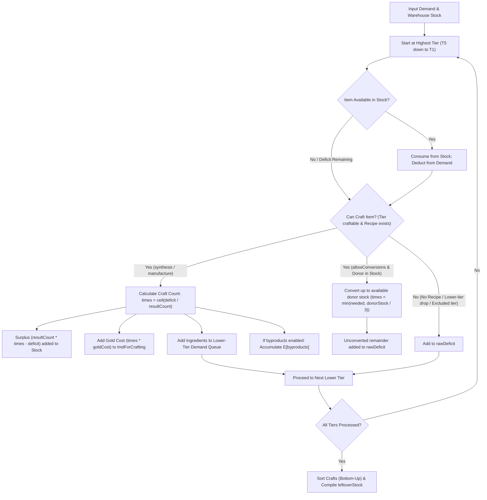

# Workshop Crafting Engine

## 1. Overview & Architecture

The Workshop Crafting Engine is implemented as pure, deterministic TypeScript functions located in `shared/utils/workshop/`.
It contains no UI dependencies, no Pinia stores, and no network I/O, ensuring universal portability between client and server runtimes.

### Core Modules

- `types.ts`: TypeScript contracts for demand inputs, warehouse inventory, resolve options, and structured results (`ResolveDemandResult`).
- `recipeGraph.ts`: Dependency graph builder that indexes recipes from `data/recipes.json` and item metadata from `data/items.json`. Provides cycle detection, tier indexing, and kind-based recipe filtering.
- `resolveDemand.ts`: Hierarchical top-down demand resolution algorithm that decomposes multi-tier crafting requirements down to base raw materials while accounting for existing inventory.
- `index.ts`: Public API re-exporting all workshop utilities and types.

---

## 2. Recipe Graph & Formulas

Recipes in `data/recipes.json` are classified into three distinct categories:

1. `synthesis`: Standard Workshop formulas for elite materials, skill summaries, and building components (tiers T2–T5).
2. `manufacture`: Base Factory formulas used for producing Dualchips (tier T5).
3. `conversion`: Workshop formulas for reciprocal 3-to-2 class chip conversions (tiers T3 and T4).

### Default Behavior

By default, `allowConversions` is `false`. The engine only incorporates `synthesis` and `manufacture` recipes.
Chip conversions are disabled by default because reciprocal conversions carry a lossy 3:2 ratio (3 donors yield 2 targets) and should not be automatically planned unless explicitly requested by the user.

---

## 3. Demand Resolution Algorithm (`resolveDemand`)

The engine processes item requirements top-down from highest tier (T5) to lowest tier (T1):

### Execution Order

The resulting `crafts` array is sorted in execution-ready (bottom-up) order:

- Lower-tier synthesis operations occur first (e.g. T2 -> T3), ensuring intermediate components are crafted before higher-tier assemblies consume them (e.g. T3 -> T4, T4 -> T5).
- Operations within the same tier are sorted deterministically by `recipeId`.

---

## 4. Chips, Chip Packs, and Catalysts

### Dualchips (T5)

- Produced exclusively via `manufacture` in the Factory (`mf_5` through `mf_12`).
- Each Dualchip recipe requires:
  - 2× corresponding class Chip Pack (T4)
  - 1× Chip Catalyst (`32001`, T4)
- Gold cost (`goldCost`) is 0.

### Chip Catalysts (`32001`, T4)

- Chip Catalysts cannot be crafted in the Workshop or Factory (`canCraft: false`).
- They are exclusively purchased from the Shop using Purchase Certificates (Red Certificates).
- When resolving demand, any needed Chip Catalysts not present in `stock` immediately become part of `rawDeficit`.

### Chips (T3) and Chip Packs (T4)

- Regular class chips (T3, `3211`–`3281`) and chip packs (T4, `3212`–`3282`) have no synthesis formulas: they only drop from PR stages.
- The only available recipes for them are 16 reciprocal conversions (8 pairs).

### The 8 Reciprocal Conversion Pairs

When `allowConversions: true` is set, the following 8 reciprocal pairs become accessible:

| Pair # | Class A (Target/Donor)          | Class B (Target/Donor)            | Formula A -> B         | Formula B -> A         |
| :----- | :------------------------------ | :-------------------------------- | :--------------------- | :--------------------- |
| 1      | Vanguard Chip (`3211`, T3)      | Supporter Chip (`3271`, T3)       | `wf_44` (3× A -> 2× B) | `wf_43` (3× B -> 2× A) |
| 2      | Vanguard Chip Pack (`3212`, T4) | Supporter Chip Pack (`3272`, T4)  | `wf_52` (3× A -> 2× B) | `wf_51` (3× B -> 2× A) |
| 3      | Guard Chip (`3221`, T3)         | Specialist Chip (`3281`, T3)      | `wf_46` (3× A -> 2× B) | `wf_45` (3× B -> 2× A) |
| 4      | Guard Chip Pack (`3222`, T4)    | Specialist Chip Pack (`3282`, T4) | `wf_54` (3× A -> 2× B) | `wf_53` (3× B -> 2× A) |
| 5      | Defender Chip (`3231`, T3)      | Medic Chip (`3261`, T3)           | `wf_40` (3× A -> 2× B) | `wf_39` (3× B -> 2× A) |
| 6      | Defender Chip Pack (`3232`, T4) | Medic Chip Pack (`3262`, T4)      | `wf_48` (3× A -> 2× B) | `wf_47` (3× B -> 2× A) |
| 7      | Sniper Chip (`3241`, T3)        | Caster Chip (`3251`, T3)          | `wf_42` (3× A -> 2× B) | `wf_41` (3× B -> 2× A) |
| 8      | Sniper Chip Pack (`3242`, T4)   | Caster Chip Pack (`3252`, T4)     | `wf_50` (3× A -> 2× B) | `wf_49` (3× B -> 2× A) |

### Cycle Safety & Conversion Rules

Because each pair forms a directed cycle of length 2:

1. **Stock-Bounded Conversion**: A conversion recipe is only executed to the extent that donor chips are **actually present in warehouse stock** (`donorStock >= 3`).
2. **Deficit Isolation**: The engine never generates artificial demand for donor chips that are not in stock. Faming a donor chip to convert at a 33% penalty is sub-optimal; unconvertible deficits remain in `rawDeficit` of the required chip.
3. **Graph Cycle Detection**: `RecipeGraph.hasCycle(startId, targetId)` and active traversal stack checks prevent recursive loops and emit structured `CYCLE_DETECTED` warnings if circular dependencies are introduced.

---

## 5. Mathematical Expectations for Byproducts

When `byproducts: true` is enabled, the engine calculates the expected mathematical quantity $\mathbb{E}[\text{count}]$ for each byproduct item:

$$\mathbb{E}[\text{count}_i] = \sum_{\text{crafts}} \text{times} \times \text{extraOutcome.count}_i \times \text{extraOutcome.probability}_i$$

- Probabilities in `data/recipes.json` take into account base workshop extra outcome rates (typically 10% or 5%).
- Expected values are rounded to 6 decimal places to prevent IEEE 754 floating-point precision artifacts.

---

## 6. Mathematical Invariants & Guarantees

1. **Monotonicity with Inventory**:
   $$\forall i: \text{rawDeficit}_{\text{no-stock}}(i) \ge \text{rawDeficit}_{\text{with-stock}}(i)$$
   Having additional inventory never increases the raw material deficit for any item.
2. **Strict Determinism**:
   Identical inputs always yield identical outputs, with all map keys and craft lists sorted deterministically.
3. **Surplus Conservation**:
   When batch formulas produce extra units (e.g. `resultCount = 16`), excess units are added directly to `leftoverStock` and can satisfy downstream requirements.
