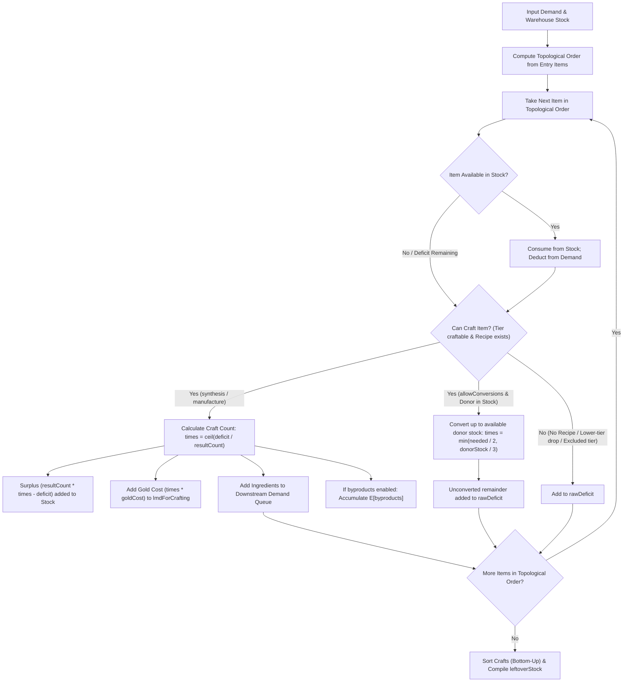

# Workshop Crafting Engine

## 1. Overview & Architecture

The Workshop Crafting Engine is implemented as pure, deterministic TypeScript functions located in `shared/utils/workshop/`.
It contains no UI dependencies, no Pinia stores, and no network I/O, ensuring universal portability between client and server runtimes.

### Core Modules

- `types.ts`: TypeScript contracts for demand inputs, warehouse inventory, resolve options, and structured results (`ResolveDemandResult`).
- `recipeGraph.ts`: Dependency graph builder that indexes recipes from `data/recipes.json` and item metadata from `data/items.json`. Provides topological DAG sorting (products to ingredients), cycle detection, tier indexing, and kind-based recipe filtering.
- `resolveDemand.ts`: Linear topological demand resolution algorithm that processes nodes in strict consumer-to-dependency order, guaranteeing the DAG invariant: **no item is evaluated before all of its consumers have been processed**.
- `index.ts`: Public API re-exporting all workshop utilities and types.

---

## 2. Recipe Graph & Formulas

Recipes in `data/recipes.json` (74 total recipes) are classified into three distinct categories:

1. `synthesis` (50 recipes): Standard Workshop formulas for elite materials, skill summaries, and building components (tiers T2–T5).
2. `manufacture` (8 recipes): Base Factory formulas used for producing Dualchips (tier T5).
3. `conversion` (16 recipes): Workshop formulas for reciprocal 3-to-2 class chip conversions (tiers T3 and T4).

### Default Behavior

By default, `allowConversions` is `false`. The engine only incorporates `synthesis` and `manufacture` recipes.
Chip conversions are disabled by default because reciprocal conversions carry a lossy 3:2 ratio (3 donors yield 2 targets) and should not be automatically planned unless explicitly requested by the user.

---

## 3. Demand Resolution Algorithm (`resolveDemand`)

The engine processes item requirements in topological order from products (top-level consumers) to base ingredients (dependencies):

### DAG Invariant Guarantee

Because items are traversed in topological order:

- If item $A$ consumes item $B$ ($A \to B$), $A$ is guaranteed to be processed **strictly before** $B$.
- When $B$ is reached, its total required quantity includes all demands generated by all upstream crafts of $A$.
- This holds true even when product and ingredient share the **same tier** (e.g. `wf_1`: `Light Building Material` (T2) requires `Carbon Stick` (T2)).

---

## 4. Chips, Chip Packs, and Catalysts (Data Audit)

All statements below are verified against `data/recipes.json` and `data/items.json`:

### Dualchips (T5): Factory Manufacture (`mf_5`–`mf_12`)

Every Dualchip formula has `kind: "manufacture"`, `roomType: "MANUFACTURE"`, `formulaType: "F_ASC"`, `goldCost: 0`, and produces `resultCount: 1`:

| Formula ID | Result Item         | Result ID | Ingredients (Exact Data)                                      | goldCost |
| :--------- | :------------------ | :-------- | :------------------------------------------------------------ | :------- |
| `mf_5`     | Vanguard Dualchip   | `3213`    | 2× `3212` (Vanguard Chip Pack) + 1× `32001` (Chip Catalyst)   | 0        |
| `mf_6`     | Guard Dualchip      | `3223`    | 2× `3222` (Guard Chip Pack) + 1× `32001` (Chip Catalyst)      | 0        |
| `mf_7`     | Defender Dualchip   | `3233`    | 2× `3232` (Defender Chip Pack) + 1× `32001` (Chip Catalyst)   | 0        |
| `mf_8`     | Sniper Dualchip     | `3243`    | 2× `3242` (Sniper Chip Pack) + 1× `32001` (Chip Catalyst)     | 0        |
| `mf_9`     | Caster Dualchip     | `3253`    | 2× `3252` (Caster Chip Pack) + 1× `32001` (Chip Catalyst)     | 0        |
| `mf_10`    | Medic Dualchip      | `3263`    | 2× `3262` (Medic Chip Pack) + 1× `32001` (Chip Catalyst)      | 0        |
| `mf_11`    | Supporter Dualchip  | `3273`    | 2× `3272` (Supporter Chip Pack) + 1× `32001` (Chip Catalyst)  | 0        |
| `mf_12`    | Specialist Dualchip | `3283`    | 2× `3282` (Specialist Chip Pack) + 1× `32001` (Chip Catalyst) | 0        |

### Chip Catalyst (`32001`, T4)

In `data/items.json`:

- `id`: `"32001"`, `name.en`: `"Chip Catalyst"`, `rarity`: `4`, `type`: `"catalyst"`.
- `flags`: `{"canDrop": false, "canCraft": false}`.
- `data/recipes.json` contains 0 recipes with `resultId: "32001"`.
- Therefore, Chip Catalyst is **uncraftable** and is purchased exclusively from the store (Red Certificates). When absent from warehouse stock, it directly enters `rawDeficit`.

### The 8 Reciprocal Chip Conversion Pairs (`wf_39`–`wf_54`)

When `allowConversions: true` is enabled, the 8 reciprocal conversion pairs are accessible. All 16 formulas have `kind: "conversion"`, `roomType: "WORKSHOP"`, `formulaType: "F_ASC"`, `goldCost: 0`, `resultCount: 2`, and `ingredients: [{ count: 3 }]`:

| Pair # | Class Pair           | Tier       | Formula A -> B (3 to 2)        | Formula B -> A (3 to 2)        |
| :----- | :------------------- | :--------- | :----------------------------- | :----------------------------- |
| 1      | Vanguard ↔ Supporter | T3 (Chips) | `wf_44`: 3× `3211` → 2× `3271` | `wf_43`: 3× `3271` → 2× `3211` |
| 2      | Vanguard ↔ Supporter | T4 (Packs) | `wf_52`: 3× `3212` → 2× `3272` | `wf_51`: 3× `3272` → 2× `3212` |
| 3      | Guard ↔ Specialist   | T3 (Chips) | `wf_46`: 3× `3221` → 2× `3281` | `wf_45`: 3× `3281` → 2× `3221` |
| 4      | Guard ↔ Specialist   | T4 (Packs) | `wf_54`: 3× `3222` → 2× `3282` | `wf_53`: 3× `3282` → 2× `3222` |
| 5      | Defender ↔ Medic     | T3 (Chips) | `wf_40`: 3× `3231` → 2× `3261` | `wf_39`: 3× `3261` → 2× `3231` |
| 6      | Defender ↔ Medic     | T4 (Packs) | `wf_48`: 3× `3232` → 2× `3262` | `wf_47`: 3× `3262` → 2× `3232` |
| 7      | Sniper ↔ Caster      | T3 (Chips) | `wf_42`: 3× `3241` → 2× `3251` | `wf_41`: 3× `3251` → 2× `3241` |
| 8      | Sniper ↔ Caster      | T4 (Packs) | `wf_50`: 3× `3242` → 2× `3252` | `wf_49`: 3× `3252` → 2× `3242` |

---

## 5. External Benchmark Comparison (arknights.wiki.gg)

Two crafting chains verified against live `arknights.wiki.gg` pages on **2026-10-14**:

### Chain 1: Orirock Concentration (`30014`, T4)

- Source URL: `https://arknights.wiki.gg/wiki/Orirock_Concentration` (Checked 2026-10-14)
- Recipe `wf_36`: 1× `30014` requires 4× `30013` (Orirock Cluster, T3) + 300 LMD.
- Intermediate `wf_35`: 1× `30013` requires 5× `30012` (Orirock Cube, T2) + 200 LMD.
- Intermediate `wf_34`: 1× `30012` requires 3× `30011` (Orirock, T1) + 100 LMD.

| Inventory Scenario            | Required Demand | Stock Available | Total Crafts Executed                 | LMD Cost  | Resulting Deficit | Status vs Wiki |
| :---------------------------- | :-------------- | :-------------- | :------------------------------------ | :-------- | :---------------- | :------------- |
| **From T3 (Stock Available)** | 1× `30014`      | 4× `30013`      | 1× `wf_36`                            | 300 LMD   | 0                 | Exact Match    |
| **From T2 (No T3 Stock)**     | 1× `30014`      | 20× `30012`     | 4× `wf_35` + 1× `wf_36`               | 1,100 LMD | 0                 | Exact Match    |
| **From T1 (No T3/T2 Stock)**  | 1× `30014`      | Empty           | 20× `wf_34` + 4× `wf_35` + 1× `wf_36` | 3,100 LMD | 60× `30011`       | Exact Match    |

### Chain 2: White Horse Kohl (`30074`, T4)

- Source URL: `https://arknights.wiki.gg/wiki/White_Horse_Kohl` (Checked 2026-10-14)
- Recipe `wf_18`: 1× `30074` requires 1× `30073` (Loxic Kohl, T3) + 1× `30023` (Sugar Pack, T3) + 1× `30103` (RMA70-12, T3) + 300 LMD.
- Intermediate `wf_32`: 1× `30023` requires 4× `30022` (Sugar Cube, T2) + 200 LMD.
- `30073` (Loxic Kohl) and `30103` (RMA70-12) are stage drops without T2 synthesis formulas (`canCraft: false`).

| Inventory Scenario                  | Required Demand | Stock Available                    | Total Crafts Executed   | LMD Cost | Resulting Deficit      | Status vs Wiki |
| :---------------------------------- | :-------------- | :--------------------------------- | :---------------------- | :------- | :--------------------- | :------------- |
| **From T3 (Stock Available)**       | 1× `30074`      | 1× `30073`, 1× `30023`, 1× `30103` | 1× `wf_18`              | 300 LMD  | 0                      | Exact Match    |
| **From T2 (Only Sugar Cube Stock)** | 1× `30074`      | 4× `30022`                         | 1× `wf_32` + 1× `wf_18` | 500 LMD  | 1× `30073`, 1× `30103` | Exact Match    |

---

## 6. Build Locking & `NUXT_IGNORE_LOCK=1`

### Root Cause

Nuxt uses `.nuxt/build.lock` to prevent concurrent write collisions during client/server bundling. When an agent or developer process runs `nuxt dev` on port 3001 or 3000, `.nuxt/build.lock` remains active. Executing a parallel `nuxt build` fails with an active build lock exception.

### Resolution & Prevention

1. **Isolated Build Directories**:
   `nuxt.config.ts` configures `buildDir: process.env.NUXT_BUILD_DIR ?? '.nuxt'`.
   The agent dev server (`npm run dev:agent`) sets `NUXT_BUILD_DIR=.nuxt-agent`, completely isolating dev artifacts from production builds.
2. **`NUXT_IGNORE_LOCK=1`**:
   Used in non-interactive verification runs where the dev server and production builder target distinct build directories or sequential tasks.
